# Chandelier — Modèle de données

Source de vérité : [`prisma/schema.prisma`](../prisma/schema.prisma). Ce document en explique les choix.

## 1. Principes

- **SIA ≠ modèle.** `AiSystem` est un usage opérationnel concret ; `AiModel` est un modèle/service sous-jacent réutilisable ; `Vendor` est l'éditeur. La relation `AiSystemModel` (N-N) porte la **description de l'utilisation** propre à chaque couple (CDC §3.1, §5.7).
- **N-N partout où la réalité l'exige** : SIA↔modèles, SIA↔fournisseurs, SIA↔actifs, SIA↔traitements RGPD, SIA↔datasets, SIA↔catégories de données / personnes, SIA↔tags, SIA↔documents, risques↔mesures, obligations↔contrôles, obligations↔preuves.
- **Champs d'attribution** : `id` (UUID), `createdAt`, `createdById`, `updatedAt`, `updatedById` sur toute entité métier. Pas de clé étrangère sur `createdById/updatedById` : les utilisateurs ne sont jamais supprimés (désactivation) et `audit_event` fait foi.
- **Suppression logique** du registre (`archivedAt`, `archiveReason`) ; aucune suppression physique d'un SIA via l'API.
- **Versionnement** : `AiSystem.version` (verrou optimiste, 409 si conflit) + `EntityVersion` (instantané JSON complet à chaque modification d'un objet sensible : SIA, évaluation, FRIA, notice) → comparaison et restauration.
- **Journal immuable** : `audit_event`, protégé par un trigger PostgreSQL qui rejette `UPDATE` et `DELETE`.
- **Données DEMO** : `isDemo=true`, références `*-DEMO-*`, libellés préfixés « [DEMO] ». Purge possible par requête ciblée.
- **Énumérations PostgreSQL** pour toutes les listes fermées (statuts, catégories) ; référentiels ouverts en tables (`DataCategory`, `DataSubjectCategory`, `Tag`, `Control`).

## 2. Diagramme (simplifié)

```mermaid
erDiagram
  OrganizationUnit ||--o{ OrganizationUnit : parent
  OrganizationUnit ||--o{ User : rattache
  OrganizationUnit ||--o{ AiSystem : porte
  User ||--o{ UserRoleAssignment : a
  Role ||--o{ UserRoleAssignment : accorde
  OrganizationUnit ||--o{ UserRoleAssignment : perimetre
  User ||--o{ Session : ouvre

  AiSystem }o--o{ AiModel : "AiSystemModel (usageDescription)"
  Vendor ||--o{ AiModel : edite
  AiSystem }o--o{ Vendor : AiSystemVendor
  AiSystem }o--o{ Stakeholder : AiSystemStakeholder
  AiSystem }o--o{ Asset : AiSystemAsset
  AiSystem }o--o{ ProcessingActivity : AiSystemProcessingActivity
  AiSystem }o--o{ Dataset : "AiSystemDataset (usages)"
  AiSystem }o--o{ DataCategory : AiSystemDataCategory
  AiSystem }o--o{ DataSubjectCategory : AiSystemDataSubject
  AiSystem }o--o{ Tag : AiSystemTag

  RegulatoryFramework ||--o{ AiActAssessment : version
  AiSystem ||--o{ AiActAssessment : qualifie
  AiActAssessment ||--o{ AssessmentOverride : surcharge
  AiSystem ||--o{ Obligation : doit
  Obligation }o--o{ Control : ObligationControl
  Obligation }o--o{ Document : ObligationEvidence

  RiskMethodology ||--o{ Risk : cote
  AiSystem ||--o{ Risk : expose
  Risk }o--o{ Measure : RiskMeasure
  AiSystem ||--o{ Action : planifie

  AiSystem ||--o{ Fria : evalue
  Dpia ||--o{ Fria : reutilisee
  ProcessingActivity ||--o{ Dpia : couvre
  AiSystem ||--o{ TransparencyNotice : informe
  Document ||--o{ DocumentVersion : versions
  AiSystem }o--o{ Document : AiSystemDocument

  AiSystem ||--o{ Approval : valide
  AiSystem ||--o{ Review : revue
```

## 3. Entités

| Entité (table) | Rôle | Points clés |
|---|---|---|
| `OrganizationUnit` | Entité / direction / département / équipe | Arbre (`parentId`) + chemin matérialisé `path` pour les contrôles de périmètre |
| `User` (`app_user`) | Compte | `authProvider` LOCAL/OIDC, `externalId` (oid Entra), `passwordHash` argon2id, verrouillage après échecs |
| `Role` | Rôle RBAC | Liste de permissions nommées ; rôles système seedés et non supprimables |
| `UserRoleAssignment` | Affectation | Rôle + périmètre (global si `orgUnitId` null ; descendants inclus par défaut) |
| `Session` | Session serveur | Jeton stocké haché (SHA-256), jeton CSRF, expiration absolue + glissante |
| `AiSystem` | SIA | Champs des étapes 1, 2, 8, 10 ; dénormalisation `riskCategory`/`complianceStatus`/`completeness` recalculées côté serveur |
| `SystemTemplate` | Gabarit de création | Création « à partir d'un modèle interne » |
| `SectionAssignment` | Affectation de section | Contributeur ↔ section du wizard |
| `Vendor` | Fournisseur/éditeur | — |
| `AiModel` | Modèle d'IA | Type, accès, hébergement, régions, GPAI (`isGpai`, `gpaiSystemicRisk`) |
| `AiSystemModel` | SIA↔modèle | `usageDescription` obligatoire, version utilisée, hébergement |
| `Stakeholder` / `AiSystemStakeholder` | Parties prenantes | Fonction (sponsor, DSI, RSSI, DPO…), RACI facultatif ; contact pro uniquement |
| `Asset` / `AiSystemAsset` | Actifs | Réutilisables entre SIA |
| `ProcessingActivity` | Traitement RGPD | Base légale, rôle RGPD, DPIA requise, `externalRef` vers le registre RGPD |
| `Dataset` / `AiSystemDataset` | Jeux de données | Origine, données perso / art. 9 / art. 10, synthétique, licence, qualité, représentativité, transferts ; usages (entraînement, fine-tuning, RAG, inférence…) par relation |
| `DataCategory`, `DataSubjectCategory` | Référentiels RGPD | Drapeaux art. 9, art. 10, vulnérabilité |
| `RegulatoryFramework` | Version de référentiel | Contenu JSON figé + `checksum` ; jamais modifié après import |
| `AiActAssessment` | Qualification AI Act | Réponses, résultat brut du moteur, catégorie calculée vs effective, version du référentiel, auteur, date |
| `AssessmentOverride` | Surcharge juriste | Dimension, ancienne/nouvelle valeur, **justification obligatoire**, auteur |
| `Obligation` | Obligation applicable | Instance d'un modèle du référentiel : base légale, applicabilité, statut, responsable, dates, preuves |
| `Control` / `ObligationControl` | Contrôles | Bibliothèque de contrôles réutilisables |
| `RiskMethodology` | Méthode de cotation | Échelles et seuils en JSON, versionnés |
| `Risk`, `Measure`, `RiskMeasure` | Registre des risques | Référence `RSK-####`, scores inhérent / résiduel = vraisemblance × gravité calculés côté serveur, rattachés à la version de méthodologie utilisée ; acceptation (motif, auteur, date) ; verrou optimiste `version`. Une `Measure` appartient à un SIA (S6) ; elle est « existante » si son statut est `IMPLEMENTED` ou `VERIFIED` (la colonne `RiskMeasure.isExisting` a été supprimée en S6) |
| `Document`, `DocumentVersion`, `ObligationEvidence`, `RiskEvidence` | Pièces et preuves (S7) | Un document appartient à un SIA **ou** à un modèle (`aiSystemId` / `aiModelId`, contrôle de périmètre) ; les tables de liaison `ai_system_document` / `ai_model_document`, jamais alimentées, ont été supprimées en S7. Chaque version : clé de stockage aléatoire, nom nettoyé, type MIME de la liste blanche, taille, SHA-256, statut d'analyse |
| `Approval`, `Review`, `Comment`, `Notification` | Workflow et collaboration (S7) | Validation par domaine pour une version (`entityVersion`) ; `AiSystem.lockedVersion` / `validatedAt` = dernière version validée ; revues périodiques ou exceptionnelles, `AiSystem.lastReviewDate` / `nextReviewDate` ; notifications in-app idempotentes (`dedupeKey`) |
| `Action` | Plan d'action | Référence `ACT-####`, rattachement obligatoire à un SIA (S6), facultatif à un risque, une obligation, une mesure du même SIA ; motif de clôture ; verrou optimiste |
| `Fria` | AIPD droits fondamentaux | Sections art. 27(1), lien `Dpia` et sections couvertes par la DPIA |
| `Dpia` | AIPD RGPD | Interne ou externe (`externalUrl`) ; thèmes couverts réutilisables |
| `TransparencyNotice` | Notice | Blocs conditionnels, Markdown, instantané des données source, versions par langue |
| `Document` / `DocumentVersion` | GED | Versions immuables, SHA-256, statut antivirus |
| `Approval` | Validation | Par domaine, sur une **version figée** de l'objet |
| `Review` | Revue | Périodique / exceptionnelle + déclencheur |
| `Comment`, `Notification`, `SavedView` | Collaboration | Mentions, vues personnelles/partagées |
| `AuditEvent` | Journal | Immuable ; acteur, origine (USER/IMPORT/API/ASSISTANT/SYSTEM), diff, justification |
| `EntityVersion` | Instantanés | Restauration et comparaison |
| `AssistantSuggestion` | Proposition IA | Statut `TO_VERIFY` → `ACCEPTED`/`REJECTED` par un humain |
| `ImportJob`, `AppSetting` | Technique | Rapports d'import ; paramètres (LLM, conservation, rappels) |

## 4. Index

Index sur les filtres usuels : statut, unité, propriétaire, catégorie de risque, valeur, prochaine revue, archivage (SIA) ; statut/échéance (actions, revues) ; entité et date (journal). Recherche plein texte : index GIN `tsvector` (français) sur nom, référence, description, finalité du SIA, ajouté en S2 par migration SQL.

## 5. Évolution

Toute évolution passe par une migration Prisma versionnée dans `prisma/migrations/` (jamais `db push` hors développement local). Procédure de rollback : `docs/BACKUP_RESTORE.md`.
